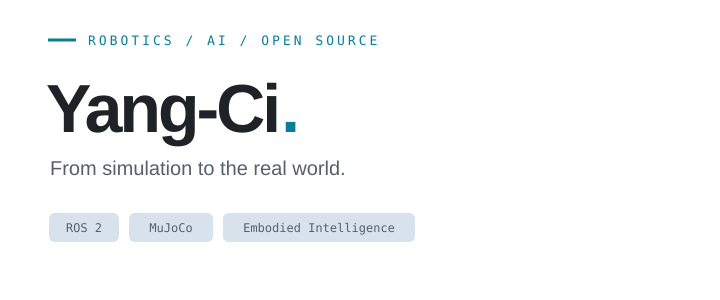

<picture>
  <source media="(prefers-color-scheme: dark)" srcset="assets/header-dark.svg" />
  <source media="(prefers-color-scheme: light)" srcset="assets/header-light.svg" />
  
</picture>

### 你好，我是 Yang-Ci 👋

专注机器人与 AI 应用开发，让想法从仿真走向真实世界。

机械臂控制 · ROS 2 · 数字孪生 · 具身智能 · 视觉与语音交互

## / 正在构建

| 项目 | 方向 |
| :--- | :--- |
| [**ReBot Arm · DM**](https://github.com/Yang-Ci/ReBot_Arm_DigitalTwin_DM) | B601-DM 机械臂数字孪生与控制：ROS 2、MoveIt、MuJoCo、硬件驱动与智能体 |
| [**ReBot Arm · RS**](https://github.com/Yang-Ci/ReBot_Arm_DigitalTwin_RS) | B601-RS 机械臂数字孪生与控制：仿真、Web 控制与真实机械臂联动 |

## / 技术工具箱

## / 持续构建

<picture>
  <source media="(prefers-color-scheme: dark)" srcset="https://streak-stats.demolab.com/?user=Yang-Ci&theme=github-dark-blue&hide_border=true&background=0D1117&ring=58D5E8&fire=F7B93E&currStreakLabel=58D5E8" />
  
</picture>

## / 贡献贪吃蛇 · Arcade Edition

> 每一次提交，都是下一步的能量。

<picture>
  <source media="(prefers-color-scheme: dark)" srcset="https://raw.githubusercontent.com/Yang-Ci/Yang-Ci/output/snake-contribution-graph-dark.svg" />
  <source media="(prefers-color-scheme: light)" srcset="https://raw.githubusercontent.com/Yang-Ci/Yang-Ci/output/snake-contribution-graph.svg" />
  
</picture>

Code a little. Build something real.

